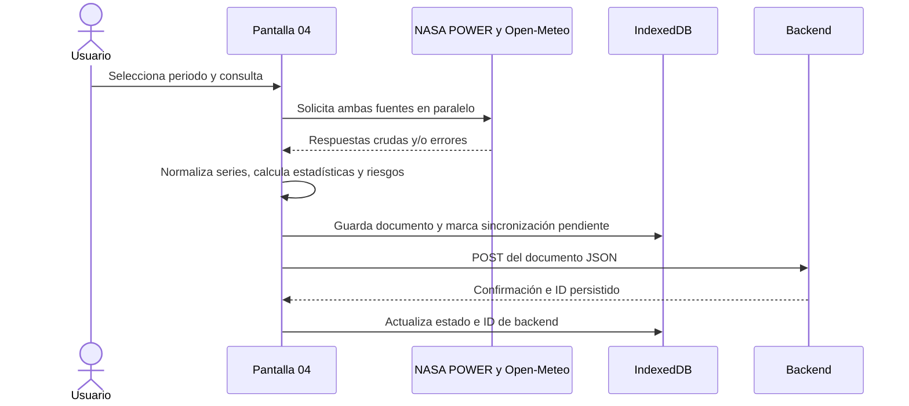

# Documentación general de SEMA

## 1. Propósito y alcance

SEMA es una aplicación web frontend para registrar una finca, explorar su ubicación en un mapa, consultar datos ambientales y revisar indicadores de riesgo. Está desarrollada con React, TypeScript y Vite.

El repositorio disponible contiene solamente el frontend. El backend, su base de datos, autenticación, registro de fincas y las rutas `/api/analisis-ambiental` aún deben implementarse e integrarse. El contrato de análisis se describe en [contrato-analisis-ambiental.example.json](./contrato-analisis-ambiental.example.json).

## 2. Estructura de la aplicación

```text
src/
  App.tsx                         Estado compartido y rutas de la SPA
  main.tsx                        Montaje de React, estilos y service worker
  components/
    layout/                       Encabezado, menú lateral y layout
    ui/                           Botón, tarjeta y estados de carga
  features/
    territorios/                  Finca, ubicación, mapa, terreno e imágenes
    analisis-ambiental/            NASA POWER, Open-Meteo, gráficas e historial
    riesgos/                      Reglas, evaluación e indicadores
  services/api.ts                 Lectura de VITE_API_BASE_URL
  types/                          Contratos TypeScript compartidos
public/service-worker.js          Shell offline y recursos estáticos visitados
docs/                             Contratos y documentación técnica
```

Las pantallas comparten el estado de la finca y el análisis a través de `App.tsx`. Los servicios de red y cálculos están separados de los componentes de interfaz para evitar duplicar peticiones y lógica.

## 3. Navegación y pantallas

| Ruta | Pantalla | Función |
|---|---|---|
| `/mi-finca` | 02 · Mi finca | Nombre, país, región, municipio y coordenadas de referencia. Al continuar se abre el mapa. |
| `/mapa` | 03 · Mapa satelital | Mapa base, dibujo de contorno, área aproximada y búsqueda de escenas Sentinel-2. Incluye enlace al análisis climático. |
| `/analisis-climatico` | 04 · Análisis climático y del suelo | Consulta de fechas y ubicación, comparación de fuentes, estadísticas, tendencias y evaluación de reglas de riesgo configuradas. |
| `/riesgos-alertas` | 05 · Riesgos y alertas | Editor de umbrales y lista de indicadores evaluados sobre el análisis disponible. |
| `/datos-historicos` | 06 · Datos históricos | Tabla paginada de observaciones y descarga del documento de análisis JSON. |

La ruta raíz redirige a `/mi-finca`. Las rutas desconocidas también redirigen allí.

## 4. Datos de finca y mapa

### Selección territorial

El formulario permite escoger país y región desde catálogos públicos; ofrece municipio/división local cuando existe información y permite introducir coordenadas manualmente. Colombia utiliza datos de DIVIPOLA para relacionar municipios con departamentos. La referencia geográfica usa latitud y longitud en WGS84.

En el navegador se persisten el nombre y la ubicación de referencia de la finca. El contorno dibujado, el área y la escena satelital seleccionada son actualmente temporales y se pierden al recargar la página.

### Contorno

El usuario puede dibujar un polígono en el mapa. Se estima el área en hectáreas con Turf y se usa el centro calculado como punto de referencia para las consultas. Es una aproximación, no una medición catastral; un centro geométrico puede caer fuera de un polígono cóncavo.

### Imágenes satelitales

El frontend busca escenas Sentinel-2 L2A en el catálogo STAC de Microsoft Planetary Computer, con filtros de fechas y nubosidad. Muestra hasta seis escenas y permite cargar el recurso de teselas de color natural. Las imágenes tienen fecha de captura; no son imágenes en tiempo real. El proveedor de imagen y el mapa base tienen sus propias condiciones y disponibilidad.

## 5. Análisis climático y del suelo

### Proveedores y datos

El frontend consulta directamente y en paralelo las APIs públicas de:

- **NASA POWER:** series diarias de temperatura, precipitación, radiación solar y humedad relativa.
- **Open-Meteo / ERA5-Land:** esas variables y humedad del suelo estimada a 0–7 cm con frecuencia horaria.

Una falla parcial no descarta la respuesta válida de la otra fuente. Se conserva la procedencia para no confundir estimaciones de modelos con mediciones tomadas dentro de la parcela. Open-Meteo requiere atribución y la API gratuita indicada por el proyecto es para uso no comercial; verificar términos y límites vigentes antes de producción.

### Normalización

Las respuestas se transforman en series comunes con:

- variable, unidad, frecuencia, tipo de dato y referencia temporal;
- periodo solicitado y observaciones ordenadas por fecha;
- valores numéricos finitos o `null` cuando falta un dato;
- proveedor, conjunto de datos, modelo, resolución y atribución cuando están disponibles.

La normalización conserva cada proveedor por separado. Las comparaciones no promedian NASA POWER con Open-Meteo.

### Gráficas, estadísticas y tendencias

La pantalla 04 contiene gráficas comparativas con selector de fuentes, filtros de periodo en consultas largas y detalles accesibles con cursor o teclado. Para que los gráficos sean legibles, las series extensas se agregan visualmente; las observaciones originales quedan en la tabla histórica.

Las tarjetas de estadísticas muestran mínimo, promedio, máximo y cantidad de observaciones válidas por fuente. Se calculan sobre los datos originales, no sobre la agregación visual.

Para la vista se muestran agregados mensuales en series diarias con periodos mayores a 90 días y agregados diarios para series horarias con periodos mayores a tres días. Se excluyen meses parciales cuando se usa agregación mensual y grupos horarios con menos del 98 % de cobertura. Las tarjetas de estadísticas siguen usando las observaciones originales.

Las tendencias usan años calendario completos y cobertura mínima del 98 %. Se calcula una pendiente lineal con al menos tres años válidos. El resultado describe la serie histórica; no es un pronóstico.

## 6. Documento JSON de análisis

El adaptador [documentoAmbiental.ts](../src/features/analisis-ambiental/services/documentoAmbiental.ts) crea y valida el contrato versionado usado por backend y exportación. El ejemplo completo está en [contrato-analisis-ambiental.example.json](./contrato-analisis-ambiental.example.json).

### Campos principales

| Campo | Descripción |
|---|---|
| `schemaVersion` | Versión del contrato; actualmente `1`. |
| `analysisId` | Identificador asignado por backend. En el envío inicial puede ser `null`; el backend debe devolver el identificador creado. |
| `farmId` | Relación con una finca registrada; `null` mientras el frontend no reciba un ID de finca. |
| `location` | Latitud y longitud consultadas. |
| `period` | Fechas de inicio y fin solicitadas. |
| `fetchedAt` | Momento de obtención de datos de los proveedores. |
| `createdAt` | Momento de creación del documento en frontend. |
| `expiresAt` | Expiración de la entidad en backend; actualmente `null`. La caché local tiene vigencia aparte. |
| `rawResponses` | Cuerpo JSON original de cada respuesta HTTP recibida, URL, estado, content type y hora de recepción. Si el cuerpo no es JSON válido, se conserva como texto. |
| `providerErrors` | Errores por proveedor para respuestas HTTP o formatos no válidos. |
| `series` | Series normalizadas y observaciones, con unidad, frecuencia, periodo y procedencia. |

Las respuestas de red que no llegan a producir un cuerpo HTTP —por ejemplo, una caída de conexión o timeout— no tienen `rawResponses`; sus errores se conservan en `providerErrors` cuando otro resultado permite crear el documento.

Las estadísticas, tendencias y gráficos son derivados y se recalculan desde `series`. No hace falta persistirlos en el backend salvo que se acuerde una estrategia de optimización.

### Entidades sugeridas para backend

1. **Farm:** identidad y propiedad de la finca. Puede relacionarse con tablas ya existentes.
2. **EnvironmentalAnalysis:** finca, ubicación, periodo, fechas, versión de esquema e ID.
3. **RawProviderResponse:** proveedor, URL, estado, cabeceras relevantes y cuerpo crudo JSON/JSONB.
4. **EnvironmentalSeries:** análisis, variable, frecuencia, unidad y procedencia.
5. **EnvironmentalObservation:** serie, fecha/hora y valor nullable.

El backend puede almacenar `rawResponses` en JSONB para conservar el documento fuente y normalizar `series`/`observations` en tablas para consultas por fecha. La elección depende de las necesidades de consulta y retención.

## 7. Contrato frontend/backend

La URL base se configura mediante `VITE_API_BASE_URL`. Todo `VITE_*` queda público en el bundle; no se deben poner secretos ahí.

### Guardar

`POST {VITE_API_BASE_URL}/api/analisis-ambiental`

- `Content-Type: application/json`
- El cuerpo es el documento descrito arriba, incluyendo observaciones normalizadas y `rawResponses`.
- El frontend acepta una respuesta JSON con el documento persistido o con un objeto que contenga `analysisId`. Actualmente cualquier respuesta 2xx no JSON o sin cuerpo también se marca como enviada; para evitar falsos positivos, el contrato recomendado es devolver el documento o un `analysisId` y endurecer la validación del cliente.
- Se recomienda devolver el documento persistido con `analysisId` para que el frontend actualice su copia local con la identidad definitiva.

### Recuperar

`GET {VITE_API_BASE_URL}/api/analisis-ambiental?latitud={lat}&longitud={lon}&inicio={YYYY-MM-DD}&fin={YYYY-MM-DD}[&fincaId={id}]`

Debe devolver todas las observaciones del documento, no solo agregados. Si no hay coincidencia, usar `404` o `204`. Acordar con backend si el match requiere coordenadas exactas, tolerancia espacial o `farmId`.

Las rutas son expectativas de integración: no existen en este repositorio. La dirección de backend de `.env.example` está vacía.

## 8. Persistencia y comportamiento offline

### En este navegador

- **`localStorage`:** borrador básico de finca y reglas de riesgo.
- **IndexedDB (`sema-cache-ambiental`):** análisis, cuerpos crudos, series y estado de sincronización pendiente. La vigencia local es de siete días.
- La clave de búsqueda local actual combina `fincaId` opcional, coordenadas exactas y fechas exactas.
- Si se abre la aplicación sin conexión, se restaura la consulta más reciente guardada para las coordenadas de la finca. También se puede solicitar offline un periodo exacto si está en caché.
- Al recuperar conexión, se reintentan los registros pendientes.
- El service worker conserva el shell de la SPA y recursos estáticos del mismo origen que ya se hayan visitado. No almacena las respuestas de APIs de clima ni las teselas externas del mapa.

La expiración local se informa, pero no se debe interpretar como eliminación automática del registro. Una política de limpieza de IndexedDB aún sería una mejora recomendada.

## 9. Riesgos y reglas

Los riesgos no se infieren con umbrales agronómicos genéricos. El usuario configura una regla que indica:

- serie, variable, unidad, frecuencia y proveedor;
- condición: menor que, mayor que o fuera de rango;
- medida de los últimos N datos válidos: último, promedio, mínimo o máximo;
- umbral(es), severidad y explicación.

La pantalla 04 vuelve a evaluar las reglas al recibir una consulta; la pantalla 05 permite crearlas y eliminarlas. Los resultados distinguen alerta activa, sin condición, sin datos, datos insuficientes o regla inválida. Actualmente las reglas se guardan en `localStorage`, no en backend.

## 10. Flujo principal de consulta



Si no hay conexión, se usa IndexedDB. Si hay conexión pero ninguna fuente devuelve series ni una respuesta HTTP con cuerpo que pueda guardarse, el frontend intenta recuperar el periodo del backend y luego la copia exacta local.

## 11. Configuración y ejecución

Requisitos indicados por el proyecto: Node.js 20.19+ o 22.12+.

```powershell
npm.cmd ci
npm.cmd run dev
```

Para conectar backend, copiar `.env.example` a `.env.local` e indicar la URL pública:

```dotenv
VITE_API_BASE_URL=https://api.ejemplo.com
```

Los scripts disponibles son `dev`, `build`, `lint` y `preview`. El backend debe permitir CORS desde el origen del frontend y desplegar fallback SPA a `index.html` para las rutas internas.

## 12. Pendientes de integración y evolución

1. Implementar `POST` y `GET` del backend, autenticación y autorización por finca.
2. Crear/recibir `farmId` en frontend y asociar análisis, reglas y ubicación.
3. Acordar límites de tamaño, frecuencia máxima, compresión, retención del JSON crudo y limpieza de caché local.
4. Definir idempotencia y respuesta POST con `analysisId`; validar de forma estricta la confirmación del servidor.
5. Decidir si las reglas de riesgo también se sincronizan con backend y quién aprueba umbrales agronómicos.
6. Incorporar pruebas automatizadas de proveedores, normalización, contrato JSON, persistencia offline, sincronización, riesgos y geometría.
7. Revisar visualmente los mapas y las gráficas en móviles y accesibilidad por teclado/lector de pantalla.
8. Definir estrategia de respaldo/exportación de finca y reglas, además del análisis ambiental descargable.
